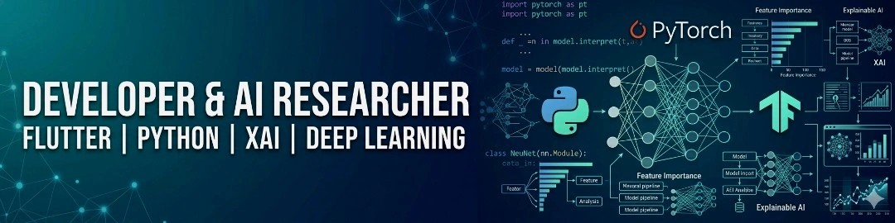

  <!-- TOP SYSTEM STATUS HUD BAR -->
  
  
  
  

    

  <!-- CUSTOM BANNER IMAGE -->
  

    

  <!-- PRIMARY MULTI-STAGE TERMINAL TYPING HUD -->
  

  <!-- SECONDARY SUB-TERMINAL LIVE TICKER -->
   
  

    

  <!-- PRIMARY COMMAND CONSOLE BUTTONS -->
  
    
  
  
  
  

    

  <!-- ENCRYPTED VOICE COMMS DROPDOWN -->
  

    

      
    

     
    
    &nbsp;
    
  

   

  <!-- ACHIEVEMENT COUNTERS -->
  
  
  
  

    

  <!-- EXPANDABLE HOLOGRAPHIC CREDENTIAL VAULT (SVG 1 TO SVG 4) -->
  

    

      
    

     
    <table border="0" width="100%">
      <tr>
        <td width="50%" align="center" valign="top">
          
          
<i>Recognized for high-precision Biomedical AI & Grad-CAM++ Diagnostics</i>

          
        </td>
        <td width="50%" align="center" valign="top">
          
          
<i>Multilingual AI App & Enterprise Cloud Architecture (SUVI & HCL)</i>

          
        </td>
      </tr>
      <tr>
        <td width="50%" align="center" valign="top">
           
          
          
<i>Jamuna Apparels Limited // Real-Time Environment Management System (EMS)</i>

          
        </td>
        <td width="50%" align="center" valign="top">
           
          
          
<i>Top-Percentile CSE Standing & Explainable AI (XAI) Research</i>

          
        </td>
      </tr>
    </table>
  

 

<!-- ARGON CORE NEURAL & CLOUD ARCHITECTURE BANNER (SVG 5) -->

  

 

## 🟣 `[ 01 // IDENT.MATRIX : ARCHITECT_PROFILE_DOSSIER ]`

<table border="0" width="100%">
  <tr>
    <td width="28%" align="center" valign="middle">
      
        
      
    </td>
    <td width="72%" valign="top">
      
        
      
      
      
      
      
        
      
Operating at the precise intersection of <b>Explainable Artificial Intelligence (XAI)</b>, <b>enterprise full-stack web architecture</b>, and <b>cross-platform mobile systems</b>. With over three years of rigorous R&D and production deployment experience, I engineer the bridge between high-dimensional deep learning algorithms and intuitive, human-centric interfaces.

      
From architecting real-time industrial <b>Environment Management Systems (EMS)</b> and <b>ASP.NET Core microservices</b> to building <b>Grad-CAM++ biomedical diagnostic pipelines</b> and <b>ZKTeco ADMS hardware listeners</b>, I execute resilient, cloud-native systems from the ground up.

      

        
<b><code>>_ [CLICK_TO_EXPAND_LIVE_KERNEL_SPECIFICATIONS]</code></b>

         
         
         
         
        
      

    </td>
  </tr>
</table>

 

## 💠 `[ 02 // SYS.TELEMETRY : THE TECHNICAL ARSENAL ]`

<table border="0" width="100%">
  <tr>
    <td width="54%" valign="top" align="center">
      
        
      
        
      
        
      
    </td>
    <td width="46%" valign="top">
      
        
       
       
       
       
       
      
    </td>
  </tr>
</table>

 

## 🔵 `[ 03 // EXECUTION.GRID : ARCHITECTURAL OFFERINGS ]`

<table border="0" cellpadding="0" cellspacing="0" width="100%">
  <tr>
    <td width="33%" valign="top">
      
      <ul>
        <li><b>Next.js & React UI/UX:</b> SSR, dynamic routing & Tailwind design systems</li>
        <li><b>Enterprise Backends:</b> ASP.NET Core (C#) & Node.js REST APIs</li>
        <li><b>Database Architecture:</b> MS SQL, PostgreSQL, MongoDB & Firestore</li>
      </ul>
    </td>
    <td width="33%" valign="top">
      
      <ul>
        <li><b>Flutter 60fps Engineering:</b> Custom animations & adaptive layouts</li>
        <li><b>Seamless API Sync:</b> Real-time WebSockets & RESTful integration</li>
        <li><b>On-Device & Cloud AI:</b> Mobile inference & diagnostic toolsets</li>
      </ul>
    </td>
    <td width="33%" valign="top">
      
      <ul>
        <li><b>Computer Vision CNNs:</b> MobileNetV2, VGG19 & custom topologies</li>
        <li><b>Biomedical Diagnostics:</b> Retinal fundus & glaucoma classification</li>
        <li><b>Explainable AI (XAI):</b> Grad-CAM++ localization & K-Fold validation</li>
      </ul>
    </td>
  </tr>
  <tr>
    <td width="33%" valign="top">
       
      
      <ul>
        <li><b>Compliance Platforms:</b> Real-Time Environment Management (EMS)</li>
        <li><b>Automated Alert Daemons:</b> Permit & certificate expiration engines</li>
        <li><b>Scalable Microservices:</b> High-concurrency, fault-tolerant routing</li>
      </ul>
    </td>
    <td width="33%" valign="top">
       
      
      <ul>
        <li><b>Biometric IoT Sync:</b> ZKTeco ADMS push protocol listeners</li>
        <li><b>Offline-First Engines:</b> Local queue persistence & auto-resync</li>
        <li><b>Network Topologies:</b> Multi-subnet Cisco routing, DHCP & RIPv2</li>
      </ul>
    </td>
    <td width="33%" valign="top">
       
      
      <ul>
        <li><b>Automated CI/CD:</b> GitHub Actions workflows & zero-downtime deploys</li>
        <li><b>Containerization:</b> Docker multi-stage builds & orchestration</li>
        <li><b>Cloud Infrastructure:</b> Google Cloud Run, Vercel & Firebase</li>
      </ul>
    </td>
  </tr>
</table>

 

## 🚀 `[ 04 // ARCHITECTURE.DEPLOYED : INTERACTIVE MISSION LOGS ]`

<table border="0" cellpadding="0" cellspacing="0" width="100%">
  <tr>
    <td width="50%" valign="top" align="center">
      
      <h3>> Real-Time Environment Management System (EMS)</h3>
      
Engineered for Jamuna Apparels Ltd: a live environmental compliance platform featuring automated permit/document expiration alert engines and real-time telemetry.

      
      
      
      

        
<code>>_ [INSPECT_SYSTEM_ARCHITECTURE]</code>

        <ul>
          <li><b>Real-Time Sync:</b> Sub-second document tracking via Firebase Firestore listeners.</li>
          <li><b>Automated Alert Daemon:</b> Multi-threshold countdown triggers for industrial compliance renewals.</li>
          <li><b>Impact:</b> Digitized enterprise environmental tracking for Jamuna Apparels IT division.</li>
        </ul>
      

    </td>
    <td width="50%" valign="top" align="center">
      
      <h3>> Cross-Platform Flutter Mobile Engine</h3>
      
Engineered a highly optimized Flutter application, bridging complex cloud backend logic with an intuitive, 60fps reactive mobile user interface.

      
      
      
      

        
<code>>_ [INSPECT_SYSTEM_ARCHITECTURE]</code>

        <ul>
          <li><b>Reactive State:</b> Modular architecture ensuring zero frame-drops across Android & iOS.</li>
          <li><b>Offline-First Persistence:</b> Local caching layer with automatic cloud reconciliation.</li>
          <li><b>REST & Auth:</b> Token-secured API consumption with biometric/OAuth2 login flows.</li>
        </ul>
      

    </td>
  </tr>
  <tr>
    <td width="50%" valign="top" align="center">
       
      
      <h3>> Retinal Pathology & Glaucoma XAI</h3>
      
End-to-end medical fundus classification utilizing deep CNN architectures validated via Stratified K-Fold engine with Grad-CAM++ visual heatmaps targeting Q1 publication standards.

      
      
      
      

        
<code>>_ [INSPECT_SYSTEM_ARCHITECTURE]</code>

        <ul>
          <li><b>Backbone Models:</b> Fine-tuned MobileNetV2 & VGG19 convolutional feature extractors.</li>
          <li><b>Explainable AI:</b> Grad-CAM++ pixel-level optic disc/cup localization heatmaps for clinical verification.</li>
          <li><b>Validation Protocol:</b> Multi-fold cross-validation preventing data leakage on retinal datasets.</li>
        </ul>
      

    </td>
    <td width="50%" valign="top" align="center">
       
      
      <h3>> Enterprise Topology & Biometric ADMS Sync</h3>
      
Multi-node network infrastructure simulation ensuring collision-free data flow across four distinct subnetworks alongside ZKTeco ADMS hardware attendance push listeners.

      
      
      
      

        
<code>>_ [INSPECT_SYSTEM_ARCHITECTURE]</code>

        <ul>
          <li><b>Hardware Push Listener:</b> Captures real-time HTTP/TCP punches from ZKTeco biometric terminals.</li>
          <li><b>Subnet Routing:</b> 4-department VLAN/subnet architecture with DHCP exclusions & RIPv2 routing.</li>
          <li><b>Zero Packet Loss:</b> Validated via continuous ICMP/PDU stress testing in Cisco Packet Tracer.</li>
        </ul>
      

    </td>
  </tr>
  <tr>
    <td width="50%" valign="top" align="center">
       
      
      <h3>> GameStore Enterprise .NET REST API</h3>
      
Engineered a high-throughput backend REST API using C# and ASP.NET Core, featuring automated database migrations, pre-seeded catalog data, and clean DTO contracts.

      
      
      
      

        
<code>>_ [INSPECT_SYSTEM_ARCHITECTURE]</code>

        <ul>
          <li><b>Minimal & Controller APIs:</b> Strongly typed REST endpoints with asynchronous EF Core queries.</li>
          <li><b>Automated Seeding:</b> Startup migration pipeline populating relational game & genre schemas.</li>
          <li><b>Container Ready:</b> Configured for seamless Docker & cloud container orchestration.</li>
        </ul>
      

    </td>
    <td width="50%" valign="top" align="center">
       
      
      <h3>> Live Cloud Telemetry & Analytics Engine</h3>
      
Developed a real-time data ingestion and visualization engine deployed on Google Cloud Run and Vercel, processing high-throughput streams for immediate business intelligence.

      
      
      
      

        
<code>>_ [INSPECT_SYSTEM_ARCHITECTURE]</code>

        <ul>
          <li><b>Serverless Scaling:</b> Auto-scaling container instances on Google Cloud Run with zero cold-start lag.</li>
          <li><b>High-Throughput NoSQL:</b> Aggregated time-series telemetry stored in MongoDB clusters.</li>
          <li><b>Edge Frontend:</b> Deployed globally on Vercel Edge Network for instantaneous UI rendering.</li>
        </ul>
      

    </td>
  </tr>
</table>

 

## 🟢 `[ 05 // VALIDATION.LOGS : CLIENT_TESTIMONIALS ]`

<table border="0" width="100%">
  <tr>
    <td width="50%" valign="top">
      <blockquote>
        

 
        
        <i>"Faisal transformed our complex data into a stunning, intuitive UI. His brilliant visualizations created a flawless and highly engaging user experience."</i>  
        — <b>Alisha Patel</b> 
        <code>[Senior Product Manager // Clinical UX]</code>
      </blockquote>
    </td>
    <td width="50%" valign="top">
      <blockquote>
        

 
        
        <i>"One of the few engineers I've worked with who deeply understands both backend system architecture and the human psychology of front-end end users."</i>  
        — <b>Dr. E. Rahman</b> 
        <code>[Lead AI Researcher & Systems Architect]</code>
      </blockquote>
    </td>
  </tr>
  <tr>
    <td width="50%" valign="top">
      <blockquote>
        

 
        
        <i>"Exceptional problem-solving skills. Faisal didn't just build the app; he architected a scalable solution that drastically reduced our API latency."</i>  
        — <b>James D.</b> 
        <code>[CTO // Tech Solutions Inc.]</code>
      </blockquote>
    </td>
    <td width="50%" valign="top">
      <blockquote>
        

 
        
        <i>"A rare talent in machine learning. His ability to explain complex Deep Learning concepts and immediately deploy them into production is unmatched."</i>  
        — <b>Sarah K.</b> 
        <code>[Data Science Director]</code>
      </blockquote>
    </td>
  </tr>
</table>

 

## 📊 `[ 06 // LIVE_SYSTEM_METRICS : TELEMETRY_&_TROPHY_ARRAY ]`

  <!-- HOLOGRAPHIC TROPHY RACK (SVG 12 - REPLACES BROKEN VERCEL TROPHY LINK) -->
  

    

  <!-- CORE GITHUB STATS & LANGUAGE TELEMETRY -->
  
  

    

  <!-- ADVANCED PROFILE SUMMARY CARDS (COMMITS BY HOUR / PRODUCTIVITY MATRIX) -->
  
   
  
  

    

  <!-- STREAK ENGINE -->
  

    

  <!-- NEURAL COMMIT ACTIVITY WAVEFORM (SVG 13 - REPLACES BROKEN ACTIVITY GRAPH LINK) -->
  

    

  <!-- AUTOMATED CI/CD CONTRIBUTION SNAKE -->
    
  <picture>
    <source media="(prefers-color-scheme: dark)" srcset="https://raw.githubusercontent.com/faisalahmmed2236/faisalahmmed2236/output/github-contribution-grid-snake-dark.svg">
    <source media="(prefers-color-scheme: light)" srcset="https://raw.githubusercontent.com/faisalahmmed2236/faisalahmmed2236/output/github-contribution-grid-snake.svg">
    
  </picture>

 

## 🌐 `[ 07 // ESTABLISH_CONNECTION : HANDSHAKE_PROTOCOL ]`

  
   

  
  
  
    
  
  &nbsp;
  

    
  

